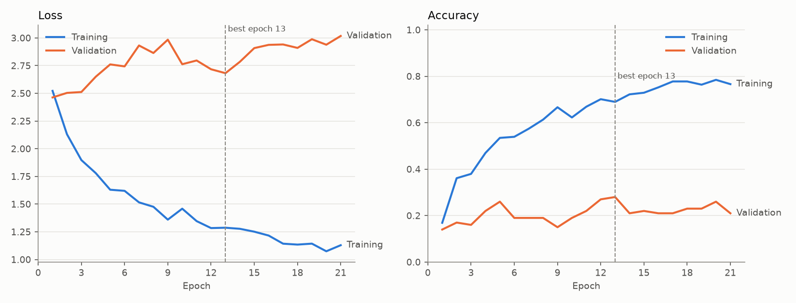

# BWorth Fabric Intelligence — Cotton Composition Demo


BWorth is a textile-recycling initiative that rewards people with redeemable tokens for discarded garments.
This repository contains an **experimental** computer-vision demo that estimates the **cotton-percentage
category** of a fabric from a photo (upload or camera), using a ResNet-50 fine-tuned on the public
*CottonFabricImageBD* dataset.

> **Not a laboratory measurement.** The model classifies image appearance into the 13 cotton percentages
> present in its training data. It does not chemically identify fibres, does not estimate the other fibres
> in a blend, and its "prediction score" is an uncalibrated softmax probability.

Scope of this phase: composition classification only (no defect / damage detection).

---

## Results at a glance

All numbers below are produced by the code in this repo (seed 42) on the **cleaned** dataset (638 images;
see *Data strategy*). Validation selects the checkpoint; the test split is touched once, at the end.

| Run | Split | Best epoch | Train acc (best ep.) | Val acc | **Test acc** | Test macro-F1 | Test top-3 | Test mean abs. error |
|---|---|---|---|---|---|---|---|---|
| **`resnet50_group_split`** (deployed, `models/composition/best_model.pth`) | swatch-aware groups | 13 / 21 | 69.0 % | 28.0 % | **32.3 %** | 0.246 | 49.5 % | 14.1 pts |
| `resnet50_random_split` (comparison only) | per image | 20 / 28 | 78.9 % | 64.6 % | 61.7 % | 0.588 | 89.4 % | 7.8 pts |

Chance level is 7.7 % (13 classes). Test sets are small (93–94 images, as few as 2 per class), so these
estimates carry roughly ±10 percentage points of sampling uncertainty.

**How to read this:** on fabric swatches it has never seen, the model is right about a third of the time and
its top-3 contains the right category about half the time. The random-split model scores ~2× higher only
because photos of the same swatch appear in both its train and test sets; that number does **not** describe
performance on a new garment. The deployed model is the group-split one.

Outputs per run in `evaluation/composition/<run>/`: `training_curves.png`, `history.csv`,
`confusion_matrix_test.png`, `confusion_matrix_test_normalized.png`, `classification_report_test.txt`,
`per_class_metrics_test.csv`, `metrics_test.json`, `metrics_val.json`, `predictions_test.csv`,
`training_summary.json`. Dataset audit: `evaluation/composition/dataset_report.json`.



---

## Project layout

```
app/streamlit_app.py               Streamlit demo (upload / camera / held-out sample)
configs/config.py                  Paths + all hyperparameters (CompositionConfig)
training/composition/
    validate_dataset.py            Dataset audit -> evaluation/composition/dataset_report.json
    dataset.py                     Indexing, de-duplication, swatch grouping, leakage-safe splits, Dataset
    transforms.py                  Train (augmenting) and eval (deterministic) transforms
    model.py                       ResNet-50 with a new 13-way head
    train.py                       Training loop (AMP, best-checkpoint, early stopping, curves)
    evaluate.py                    Test-set metrics, confusion matrices, classification report
inference/composition/predict.py   CompositionPredictor + CLI
utils/                             device, image loading, plotting helpers
tests/                             pytest suite
models/composition/                checkpoints (git-ignored)
processed/composition/             split CSVs (git-ignored, reproducible from the seed)
evaluation/composition/            dataset report, metrics, plots
main.py                            convenience CLI wrapper
```

## Setup

```bash
python -m venv venv
venv\Scripts\activate                      # Windows  (source venv/bin/activate on Linux/macOS)
pip install torch torchvision --index-url https://download.pytorch.org/whl/cu128   # GPU build
pip install -r requirements.txt
```

Place the dataset at `datasets/compositions/CottonFabricImageBD/` (with `Original/`, `Augmented/`, `read_me.pdf`).

> **Windows note:** if `torch.cuda.is_available()` is `False` on a machine with an NVIDIA GPU, check that the
> environment variable `CUDA_VISIBLE_DEVICES` is not set to `-1` (it hides every GPU). In this development
> environment it was set at user level, so commands were run with `CUDA_VISIBLE_DEVICES=0`.

## Usage

All commands run from the project root (`python main.py <command>` is an equivalent shortcut).

| Step | Command |
|---|---|
| Audit the dataset | `python -m training.composition.validate_dataset --full` |
| Train (swatch-aware split, default) + test evaluation | `python -m training.composition.train` |
| Train the image-level comparison model | `python -m training.composition.train --split-strategy random --run-name resnet50_random_split --checkpoint-path models/composition/resnet50_random_split.pth` |
| Re-evaluate a checkpoint | `python -m training.composition.evaluate --checkpoint models/composition/best_model.pth` |
| Predict one image | `python -m inference.composition.predict path/to/fabric.jpg` |
| Launch the app | `streamlit run app/streamlit_app.py` |
| Run tests | `python -m pytest -q tests` |

Every `CompositionConfig` field can be overridden on the training command line, e.g.
`--epochs 40 --batch-size 8 --image-size 288 --resize-size 330 --lr-backbone 5e-5 --amp false`.

Python API:

```python
from inference.composition.predict import CompositionPredictor
p = CompositionPredictor()                 # models/composition/best_model.pth
r = p.predict("fabric.jpg")                # path, bytes, file object or PIL image
r.predicted_label, r.score, r.probabilities
```

Missing/empty checkpoints raise `CheckpointNotFoundError`, unusable ones `InvalidCheckpointError`,
unreadable images `InvalidImageError`. The app refuses to predict without a trained checkpoint.

## Data strategy (read this before trusting any accuracy number)

The audit (`evaluation/composition/dataset_report.json`) found:

* **13 classes** — 30, 40, 50, 53, 58, 60, 63, 65, 66, 80, 95, 98, 99 % cotton; 100 originals each (1,300),
  2,100 augmented each (2,105 in `99cotton`, which has 5 extra files with random suffixes). All images
  are readable; all but one are 900×1200.
* **`Augmented/` cannot be mapped to its source originals.** Files are named by a global running index, the
  readme documents no mapping, and the images are rotated/cropped copies (623 are byte-identical copies of
  originals). Using them would leak near-copies of test images into training, so **`Augmented/` is not used**;
  augmentation is applied on the fly to training images only.
* **Heavy duplication in `Original/`**: only 889 of 1,300 files are unique.
* **Label conflicts**: 240 duplicate clusters contain the *same image under different cotton labels*
  (mostly 60↔63, 80↔95, 65↔66, 53↔58, 98↔99). 538 images in those clusters are dropped because no correct
  label exists for them. This leaves **638 clean images** (60 % and 63 % cotton keep only 19 and 17).
* **Few physical swatches per class**: each class is many photos of roughly 6–20 fabric swatches. A random
  image split puts photos of the same swatch in train and test, so the model can score well by recognising
  the swatch (often just its colour) rather than anything about composition.

Splitting procedure (`training/composition/dataset.py`):

1. Collapse exact/near duplicates (perceptual hash, Hamming ≤ 8 of 256 bits) to one image; drop clusters with
   conflicting labels.
2. **Group split (default, deployed model):** cluster each class into approximate swatch groups using ImageNet
   ResNet-50 embeddings (average-linkage cosine clustering, threshold 0.35, chosen by visual inspection) and
   assign *whole groups* to train / val / test (≈70/15/15 per class, seed 42). The grouping is heuristic, so
   some visually different crops of one swatch may still land in separate groups; treat the group-split test
   score as an honest but possibly slightly optimistic estimate of performance on new garments.
3. **Random split (comparison only):** the same clean images split per image. This shows how much the
   swatch shortcut inflates accuracy.
4. A leakage check fails the run if any duplicate cluster or group spans two splits.

Class balance: originals are perfectly balanced, but cleaning removes unevenly, so the training loss uses
inverse-frequency class weights (`class_weighted_loss=True`).

## Model and training

* torchvision ResNet-50, ImageNet `IMAGENET1K_V2` weights, `fc` replaced by Dropout(0.3) + Linear(2048→13).
* Input: resize shorter side to 366, crop 320 (random-resized crop for training, centre crop for eval),
  ImageNet normalisation. Training augmentation: flips, 90° rotation, colour jitter (incl. small hue shift to
  discourage colour memorisation), occasional blur.
* AdamW (backbone lr 1e-4, head lr 1e-3, wd 1e-4), cosine schedule, label smoothing 0.1, batch 16, mixed
  precision on CUDA, up to 30 epochs with early stopping (patience 8) on validation accuracy.
* The best-validation checkpoint stores the weights, `class_to_idx`/`idx_to_class`, the exact preprocessing
  dict and the full config, so inference reproduces training preprocessing exactly.
* Fits a 4 GB laptop GPU (RTX 3050): ~10 s/epoch. On Windows keep `num_workers` at 2 or lower on 16 GB RAM,
  because each worker re-imports PyTorch (`RuntimeError: bad allocation` otherwise).

## Known limitations

* **Weak generalisation to new fabrics** (32 % test accuracy on unseen swatches). Validation loss rises from
  the first epochs while training accuracy keeps climbing: with ~6–20 swatches per class the network mostly
  memorises swatches. More *distinct* fabrics per class matter far more than more photos of the same ones.
* **The dataset labels are partly unreliable.** 240 images appear under two or more cotton labels; adjacent
  classes (60/63, 65/66, 53/58, 98/99, 80/95) are probably not separable from appearance at all.
  Merging them into coarser bands (e.g. <50 %, 50–70 %, 80–95 %, ≥98 %) is the most likely route to a
  useful classifier and is a recommended next experiment.
* 60 % and 63 % cotton have only 19 and 17 clean images (2 test images each); their per-class metrics are
  essentially anecdotal.
* Swatch groups are inferred by clustering, not given by the dataset, so a little residual leakage between
  splits is possible.
* Categorical output only: the model cannot predict cotton percentages outside the 13 training classes and
  says nothing about the remaining fibres (polyester, elastane, …).
* The prediction score is an uncalibrated softmax probability, not a confidence guarantee.
* Training images are close-ups taken under consistent conditions; phone photos with different distance,
  lighting, blur or background will be out of distribution and less reliable.
